# AgriNexus AI — Angular Component Hierarchy & UI Design System
**Framework:** Angular 18+ (Standalone Components, TypeScript, SCSS)  
**State Architecture:** Angular Signals + RxJS Data Streams  
**Design Philosophy:** Premium Agricultural SaaS (Clean, Earth-toned, High Contrast, Responsive)  

---

## 1. Design System Tokens & Styling Standards

### 1.1 Color Palette Tokens (SCSS Variables)

```scss
// Primary AgTech Forest Greens
$color-forest-900: #081c15; // Darkest forest green (Deep background / headers)
$color-forest-800: #1b4332; // Brand Primary (Sidebar, primary buttons)
$color-emerald-700: #2d6a4f; // Accent green (Cards, highlights)
$color-emerald-600: #40916c; // Secondary buttons & active links
$color-sage-500:    #52b788; // Vibrant indicator (Success badges, healthy crops)
$color-sage-300:    #95d5b2; // Soft border highlight, badge background
$color-sage-100:    #d8f3dc; // Light alert tint

// Neutrals & Surface Tones
$color-surface-bg:   #f8f9fa; // Warm white background (Reduces eye fatigue)
$color-surface-card: #ffffff; // Pure white card surfaces
$color-surface-border: #e9ecef; // Clean divider lines

// Typography Tones
$color-text-primary:   #212529; // High-contrast neutral dark
$color-text-secondary: #495057; // Secondary metadata, table headers
$color-text-muted:     #6c757d; // Timestamps, helper text
$color-text-inverse:   #ffffff; // Text on forest green surfaces

// Status & Diagnostic Indicators
$color-status-healthy:  #2d6a4f; // Optimal condition
$color-status-mild:     #d4a373; // Mild caution
$color-status-moderate: #e76f51; // Action needed
$color-status-critical: #d90429; // Critical pest/weather alert
```

### 1.2 Typography & Spacing Hierarchy
- **Font Family:** `'Plus Jakarta Sans'`, `'Inter'`, system-ui, sans-serif
- **Scale:**
  - Display Title: `28px` / SemiBold (600)
  - Section Heading: `20px` / SemiBold (600)
  - Subheading / Card Header: `16px` / Medium (500)
  - Body Text: `14px` / Regular (400)
  - Small / Badge: `12px` / Medium (500)
- **Spacing Grid:** $4\text{px}$ base grid ($8\text{px}, 12\text{px}, 16\text{px}, 24\text{px}, 32\text{px}, 48\text{px}$).
- **Card Radius:** `12px` rounded border with subtle elevation shadow: `0 2px 8px rgba(0, 0, 0, 0.04)`.

---

## 2. Component Hierarchy & Architectural Tree

```mermaid
flowchart TD
    AppRoot["AppComponent\n(Root Router Outlet & Global Notifications)"]
    
    subgraph LayoutGroup["Main Application Shell"]
        AppShell["AppLayoutComponent"]
        Navbar["NavbarComponent\n(Brand, User Profile, Case Study Switcher)"]
        Sidebar["SidebarComponent\n(Nav Links, Farm Quick Selector)"]
        Footer["FooterComponent\n(Group 9, HCL Demo Info)"]
        
        AppShell --> Navbar
        AppShell --> Sidebar
        AppShell --> Footer
    end
    
    subgraph FeatureModules["Feature Views (Lazy-Loaded Routes)"]
        Dashboard["DashboardComponent\n(Executive KPI Summary)"]
        ParcelsView["ParcelsComponent\n(GIS Parcel Management)"]
        SoilView["SoilHealthComponent\n(Nutrient Analyzer & Health Card)"]
        DiseaseView["DiseaseDetectorComponent\n(Leaf Scanner & AI Diagnostics)"]
        WeatherView["WeatherAdvisoryComponent\n(Agro-Meteorological Forecast)"]
        MarketView["MarketTrendsComponent\n(APMC Mandi Intelligence)"]
    end
    
    subgraph SharedComponents["Reusable Design System Components"]
        StatCard["StatCardComponent"]
        EChartCard["EChartCardComponent"]
        GeoMap["GeoMapComponent (Leaflet)"]
        StatusBadge["StatusBadgeComponent"]
        AlertBanner["AlertBannerComponent"]
        ImageDropzone["ImageDropzoneComponent"]
        DataTable["DataTableComponent"]
    end
    
    AppRoot --> AppShell
    AppShell --> Dashboard
    AppShell --> ParcelsView
    AppShell --> SoilView
    AppShell --> DiseaseView
    AppShell --> WeatherView
    AppShell --> MarketView
    
    Dashboard --> StatCard
    Dashboard --> EChartCard
    Dashboard --> GeoMap
    Dashboard --> AlertBanner
    
    ParcelsView --> GeoMap
    ParcelsView --> StatusBadge
    
    SoilView --> StatCard
    SoilView --> EChartCard
    SoilView --> DataTable
    
    DiseaseView --> ImageDropzone
    DiseaseView --> StatusBadge
    
    WeatherView --> EChartCard
    WeatherView --> StatCard
    
    MarketView --> EChartCard
    MarketView --> DataTable
```



---

## 3. Angular Routing Architecture

```typescript
// app.routes.ts specification
export const routes: Routes = [
  {
    path: 'auth',
    loadChildren: () => import('./features/auth/auth.routes').then(m => m.AUTH_ROUTES)
  },
  {
    path: '',
    component: AppLayoutComponent,
    canActivate: [AuthGuard],
    children: [
      { path: '', redirectTo: 'dashboard', pathMatch: 'full' },
      {
        path: 'dashboard',
        loadComponent: () => import('./features/dashboard/dashboard.component').then(m => m.DashboardComponent),
        title: 'AgriNexus AI — Executive Dashboard'
      },
      {
        path: 'parcels',
        loadComponent: () => import('./features/parcels/parcels.component').then(m => m.ParcelsComponent),
        title: 'AgriNexus AI — GIS Parcel Management'
      },
      {
        path: 'soil-health',
        loadComponent: () => import('./features/soil-health/soil-health.component').then(m => m.SoilHealthComponent),
        title: 'AgriNexus AI — Soil Health & NPK Analyzer'
      },
      {
        path: 'disease-detector',
        loadComponent: () => import('./features/disease-detector/disease-detector.component').then(m => m.DiseaseDetectorComponent),
        title: 'AgriNexus AI — Crop Leaf Vision Diagnostics'
      },
      {
        path: 'weather',
        loadComponent: () => import('./features/weather/weather.component').then(m => m.WeatherComponent),
        title: 'AgriNexus AI — Weather & Microclimate'
      },
      {
        path: 'market-trends',
        loadComponent: () => import('./features/market-trends/market-trends.component').then(m => m.MarketTrendsComponent),
        title: 'AgriNexus AI — APMC Mandi Intelligence'
      }
    ]
  },
  { path: '**', redirectTo: 'dashboard' }
];
```

---

## 4. Reusable Component Contracts

### 4.1 `StatCardComponent`
Displays key quantitative indicators with contextual delta indicators.
- **Inputs:**
  - `label: string` (e.g., `"Active Crop Area"`)
  - `value: string | number` (e.g., `"5.0 Acres"`)
  - `subtext: string` (e.g., `"3 Active Parcels in Rahata"`)
  - `icon: string` (Lucide or Material icon name)
  - `trend: { direction: 'up' | 'down' | 'neutral', text: string }`
  - `colorTheme: 'forest' | 'emerald' | 'sage' | 'amber' | 'crimson'`

### 4.2 `GeoMapComponent` (Leaflet Wrapper)
Handles map initialization, polygon boundary rendering, and parcel interaction.
- **Inputs:**
  - `centerCoordinates: [number, number]` (Default: Rahata `[19.7126, 74.4842]`)
  - `zoomLevel: number` (Default: `16`)
  - `parcels: Parcel[]` (Contains GeoJSON polygon geometries and crop color coding)
  - `interactive: boolean` (Allow polygon click to select parcel)
- **Outputs:**
  - `parcelSelected: EventEmitter<string>` (Emits parcel ID on polygon click)

### 4.3 `EChartCardComponent`
Reusable container for Apache ECharts with automatic responsiveness.
- **Inputs:**
  - `title: string`
  - `subtitle?: string`
  - `chartOptions: echarts.EChartsOption` (Full ECharts configuration)
  - `loading: boolean`
  - `height: string` (Default: `'320px'`)

### 4.4 `ImageDropzoneComponent`
Dedicated drag-and-drop leaf image capture module for crop disease analysis.
- **Inputs:**
  - `allowedFormats: string[]` (`['image/jpeg', 'image/png', 'image/webp']`)
  - `maxFileSizeMb: number` (`10`)
  - `previewUrl?: string`
- **Outputs:**
  - `fileSelected: EventEmitter<File>`
  - `uploadCancelled: EventEmitter<void>`

---

## 5. State Management & Data Flow Architecture

The Angular application utilizes a **Signal-first reactivity model** supplemented by RxJS for asynchronous HTTP orchestration:
1. **Services as State Stores:** Each domain service (e.g., `FarmService`, `WeatherService`) maintains private writable signals (`#farmState = signal<Farm | null>(null)`) and exposes read-only signals (`public readonly farm = this.#farmState.asReadonly()`).
2. **Computed Signals for Derived Metrics:** Total acreage, deficit nutrient counts, and high-priority alerts are computed reactively (`computed(() => ...)`), ensuring zero redundant re-renders.
3. **HTTP Interceptor Pipeline:**
   - `AuthInterceptor`: Injects the Bearer JWT token into outgoing requests.
   - `ErrorInterceptor`: Catches RFC 7807 problem details and dispatches toast notifications to the user.
