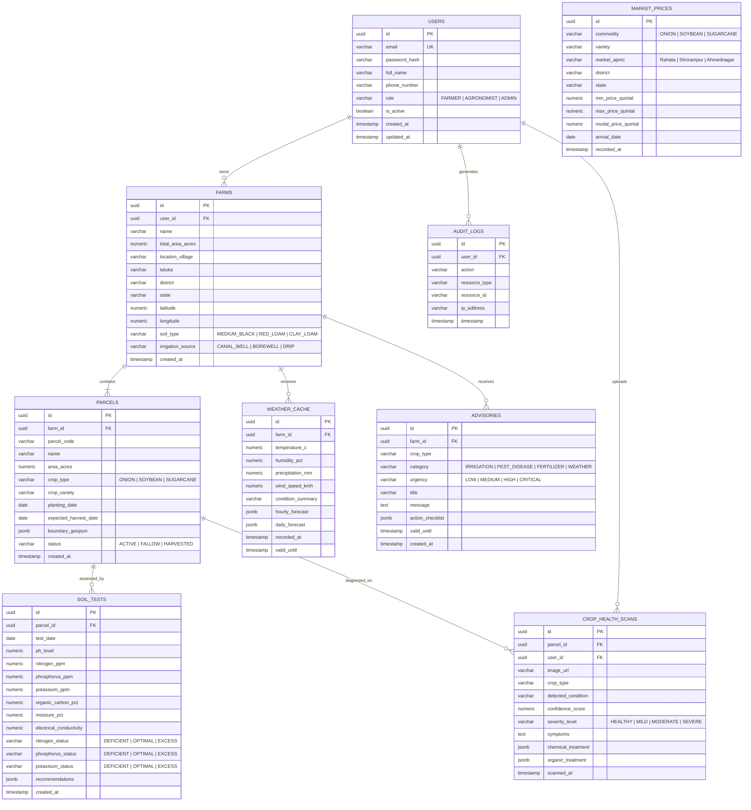

# AgriNexus AI — Relational Database Design Document
**Database System:** PostgreSQL 15+  
**ORM:** SQLAlchemy 2.0 (Declarative Mapping)  
**Schema Version:** 1.0.0-phase1  

---

## 1. Entity-Relationship (ER) Model



---

## 2. Table Specifications & Constraints

### 2.1 Table: `users`
Stores user identity, credentials, and role authorizations.
- `id` (UUID, Primary Key, Default: `gen_random_uuid()`)
- `email` (VARCHAR(255), Unique, Not Null, B-Tree Index)
- `password_hash` (VARCHAR(255), Not Null)
- `full_name` (VARCHAR(150), Not Null)
- `phone_number` (VARCHAR(20), Nullable)
- `role` (VARCHAR(30), Not Null, Check: `role IN ('FARMER', 'AGRONOMIST', 'ADMIN')`, Default: `'FARMER'`)
- `is_active` (BOOLEAN, Not Null, Default: `TRUE`)
- `created_at` (TIMESTAMPTZ, Not Null, Default: `CURRENT_TIMESTAMP`)
- `updated_at` (TIMESTAMPTZ, Not Null, Default: `CURRENT_TIMESTAMP`)

### 2.2 Table: `farms`
Represents an agricultural holding associated with a farmer.
- `id` (UUID, Primary Key, Default: `gen_random_uuid()`)
- `user_id` (UUID, Not Null, Foreign Key &rarr; `users(id)` ON DELETE CASCADE)
- `name` (VARCHAR(150), Not Null)
- `total_area_acres` (NUMERIC(6, 2), Not Null, Check: `total_area_acres > 0`)
- `location_village` (VARCHAR(100), Not Null)
- `taluka` (VARCHAR(100), Not Null)
- `district` (VARCHAR(100), Not Null)
- `state` (VARCHAR(100), Not Null, Default: `'Maharashtra'`)
- `latitude` (NUMERIC(9, 6), Not Null)
- `longitude` (NUMERIC(9, 6), Not Null)
- `soil_type` (VARCHAR(50), Not Null, Check: `soil_type IN ('BLACK_COTTON', 'MEDIUM_BLACK', 'RED_LOAM', 'ALLUVIAL')`)
- `irrigation_source` (VARCHAR(50), Not Null, Check: `irrigation_source IN ('CANAL', 'WELL', 'BOREWELL', 'DRIP', 'RIVER')`)
- `created_at` (TIMESTAMPTZ, Not Null, Default: `CURRENT_TIMESTAMP`)

### 2.3 Table: `parcels`
Represents individual sub-plots within a farm dedicated to specific crops.
- `id` (UUID, Primary Key, Default: `gen_random_uuid()`)
- `farm_id` (UUID, Not Null, Foreign Key &rarr; `farms(id)` ON DELETE CASCADE)
- `parcel_code` (VARCHAR(20), Not Null) -- e.g., 'PLOT-01-ONION'
- `name` (VARCHAR(100), Not Null)
- `area_acres` (NUMERIC(5, 2), Not Null, Check: `area_acres > 0`)
- `crop_type` (VARCHAR(50), Not Null, Check: `crop_type IN ('ONION', 'SOYBEAN', 'SUGARCANE', 'FALLOW')`)
- `crop_variety` (VARCHAR(100), Nullable) -- e.g., 'Bhima Super', 'JS 335', 'Co 86032'
- `planting_date` (DATE, Nullable)
- `expected_harvest_date` (DATE, Nullable)
- `boundary_geojson` (JSONB, Not Null) -- Leaflet polygon geometry coordinates
- `status` (VARCHAR(30), Not Null, Check: `status IN ('SOWING', 'VEGETATIVE', 'FLOWERING', 'MATURITY', 'HARVESTED', 'FALLOW')`)
- `created_at` (TIMESTAMPTZ, Not Null, Default: `CURRENT_TIMESTAMP`)

### 2.4 Table: `soil_tests`
Stores physicochemical laboratory and field sensor analysis per parcel.
- `id` (UUID, Primary Key, Default: `gen_random_uuid()`)
- `parcel_id` (UUID, Not Null, Foreign Key &rarr; `parcels(id)` ON DELETE CASCADE)
- `test_date` (DATE, Not Null)
- `ph_level` (NUMERIC(4, 2), Not Null, Check: `ph_level BETWEEN 0 AND 14`)
- `nitrogen_ppm` (NUMERIC(6, 2), Not Null)
- `phosphorus_ppm` (NUMERIC(6, 2), Not Null)
- `potassium_ppm` (NUMERIC(6, 2), Not Null)
- `organic_carbon_pct` (NUMERIC(4, 2), Nullable)
- `moisture_pct` (NUMERIC(5, 2), Nullable)
- `electrical_conductivity` (NUMERIC(5, 2), Nullable) -- dS/m
- `nitrogen_status` (VARCHAR(20), Not Null) -- 'DEFICIENT', 'OPTIMAL', 'EXCESS'
- `phosphorus_status` (VARCHAR(20), Not Null)
- `potassium_status` (VARCHAR(20), Not Null)
- `recommendations` (JSONB, Nullable) -- Fertilizer dosage, soil amendments
- `created_at` (TIMESTAMPTZ, Not Null, Default: `CURRENT_TIMESTAMP`)

### 2.5 Table: `crop_health_scans`
Maintains computer vision leaf scan diagnostics and agronomic treatment prescriptions.
- `id` (UUID, Primary Key, Default: `gen_random_uuid()`)
- `parcel_id` (UUID, Not Null, Foreign Key &rarr; `parcels(id)` ON DELETE CASCADE)
- `user_id` (UUID, Not Null, Foreign Key &rarr; `users(id)` ON DELETE RESTRICT)
- `image_url` (VARCHAR(500), Not Null)
- `crop_type` (VARCHAR(50), Not Null)
- `detected_condition` (VARCHAR(150), Not Null) -- e.g., 'Purple Blotch', 'Soybean Rust', 'Healthy'
- `confidence_score` (NUMERIC(5, 4), Not Null, Check: `confidence_score BETWEEN 0 AND 1`)
- `severity_level` (VARCHAR(20), Not Null, Check: `severity_level IN ('HEALTHY', 'MILD', 'MODERATE', 'SEVERE')`)
- `symptoms` (TEXT, Nullable)
- `chemical_treatment` (JSONB, Nullable)
- `organic_treatment` (JSONB, Nullable)
- `scanned_at` (TIMESTAMPTZ, Not Null, Default: `CURRENT_TIMESTAMP`)

### 2.6 Table: `weather_cache`
Provides cached localized microclimate telemetry with time-to-live expiration.
- `id` (UUID, Primary Key, Default: `gen_random_uuid()`)
- `farm_id` (UUID, Not Null, Foreign Key &rarr; `farms(id)` ON DELETE CASCADE)
- `temperature_c` (NUMERIC(4, 1), Not Null)
- `humidity_pct` (NUMERIC(4, 1), Not Null)
- `precipitation_mm` (NUMERIC(5, 2), Not Null)
- `wind_speed_kmh` (NUMERIC(5, 2), Not Null)
- `condition_summary` (VARCHAR(100), Not Null)
- `hourly_forecast` (JSONB, Nullable)
- `daily_forecast` (JSONB, Nullable)
- `recorded_at` (TIMESTAMPTZ, Not Null)
- `valid_until` (TIMESTAMPTZ, Not Null)

### 2.7 Table: `market_prices`
Stores APMC Mandi commodity rates for price trend analytics and harvesting guidance.
- `id` (UUID, Primary Key, Default: `gen_random_uuid()`)
- `commodity` (VARCHAR(50), Not Null, Index)
- `variety` (VARCHAR(100), Nullable)
- `market_apmc` (VARCHAR(100), Not Null, Index)
- `district` (VARCHAR(100), Not Null)
- `state` (VARCHAR(100), Not Null, Default: `'Maharashtra'`)
- `min_price_quintal` (NUMERIC(8, 2), Not Null)
- `max_price_quintal` (NUMERIC(8, 2), Not Null)
- `modal_price_quintal` (NUMERIC(8, 2), Not Null)
- `arrival_date` (DATE, Not Null, Index)
- `recorded_at` (TIMESTAMPTZ, Not Null, Default: `CURRENT_TIMESTAMP`)

### 2.8 Table: `advisories`
Proactive operational recommendations generated by agronomic rule engines and AI.
- `id` (UUID, Primary Key, Default: `gen_random_uuid()`)
- `farm_id` (UUID, Not Null, Foreign Key &rarr; `farms(id)` ON DELETE CASCADE)
- `crop_type` (VARCHAR(50), Nullable)
- `category` (VARCHAR(50), Not Null) -- 'IRRIGATION', 'PEST_DISEASE', 'FERTILIZER', 'MARKET'
- `urgency` (VARCHAR(20), Not Null, Check: `urgency IN ('LOW', 'MEDIUM', 'HIGH', 'CRITICAL')`)
- `title` (VARCHAR(200), Not Null)
- `message` (TEXT, Not Null)
- `action_checklist` (JSONB, Nullable)
- `valid_until` (TIMESTAMPTZ, Nullable)
- `created_at` (TIMESTAMPTZ, Not Null, Default: `CURRENT_TIMESTAMP`)

---

## 3. Database Indexes

```sql
-- Indexes for rapid lookup and performance optimization
CREATE INDEX idx_users_email ON users(email);
CREATE INDEX idx_farms_user_id ON farms(user_id);
CREATE INDEX idx_parcels_farm_id ON parcels(farm_id);
CREATE INDEX idx_parcels_crop_type ON parcels(crop_type);
CREATE INDEX idx_soil_tests_parcel_id ON soil_tests(parcel_id);
CREATE INDEX idx_crop_scans_parcel_id ON crop_health_scans(parcel_id);
CREATE INDEX idx_crop_scans_scanned_at ON crop_health_scans(scanned_at DESC);
CREATE INDEX idx_weather_cache_farm_valid ON weather_cache(farm_id, valid_until DESC);
CREATE INDEX idx_market_prices_query ON market_prices(commodity, market_apmc, arrival_date DESC);
CREATE INDEX idx_advisories_farm_urgency ON advisories(farm_id, urgency);
CREATE INDEX idx_parcels_geojson ON parcels USING GIN (boundary_geojson);
```

---

## 4. Case Study Seed Profile: Rahata, Ahilyanagar

To ensure authentic verification and viva presentation, the database will be seeded with the Rahata case study profile:
- **Farmer Identity:** Dnyaneshwar Kisan Shinde (`farmer.rahata@agrinexus.ai`)
- **Location:** Village: Chitali / Rahata, Taluka: Rahata, District: Ahilyanagar (Ahmednagar), Maharashtra.
- **Coordinates:** $19.7126^\circ\text{ N}, 74.4842^\circ\text{ E}$
- **Total Area:** 5.00 Acres
- **Soil Type:** Medium Black (*Vertisol*) with high moisture retention capacity.
- **Irrigation:** Pravara Canal System + Dug well with localized Drip Irrigation.

### Parcel Allocation
1. **Parcel 1 (2.0 Acres):** Rabi Onion (Variety: *Bhima Super*). Planted 15 Dec 2024. Status: Vegetative / Bulb Development.
2. **Parcel 2 (1.5 Acres):** Soybean (Variety: *JS 335*). Planted during Kharif / Rotational Fallow preparation. Status: Active.
3. **Parcel 3 (1.5 Acres):** Sugarcane Adsali / Pre-seasonal (Variety: *Co 86032*). Planted July 2024. Status: Grand Growth Stage.
