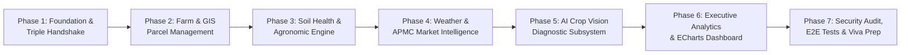

# AgriNexus AI — Development Roadmap & Phased Execution Plan
**Engineering Standard:** Modular Clean Architecture & Test-Driven Verification  
**Evaluation Target:** HCL Project Viva & Technical Demonstration  
**Project Group:** Group 9  

---

## 1. Roadmap Overview & Phased Architecture

---

## 2. Detailed Phase Specifications

### Phase 1: Project Foundation, Core Architecture & Triple-Handshake Verification
- **Objective:** Establish the foundational infrastructure across Frontend (Angular), Backend (FastAPI), and Database (PostgreSQL). Ensure the full network loop (Browser &rarr; API &rarr; Database &rarr; Browser) executes reliably.
- **Inputs:**
  - Standard development runtimes (Node.js 20+, Python 3.11+, PostgreSQL 15+).
  - Clean repository structure.
- **Deliverables:**
  - Automated database initialization script (`init_db.py`) creating tables and seed data.
  - FastAPI application with CORS, exception handlers, and `/api/v1/health` verifying DB connectivity.
  - Angular project setup with SCSS design tokens, standalone structure, and HTTP service calling backend.
  - Comprehensive triple-handshake integration test script (`test_connectivity.py`).
- **Independent Verification Criteria:**
  - Run `test_connectivity.py`: DB connects, creates a temporary test record, reads it back, tests password hashing, and returns exit code 0.
  - `GET http://localhost:8000/api/v1/health` returns `{"database": "connected", "status": "healthy"}`.
  - Angular UI shows a live green "System Status: Online" indicator fed by backend response.

---

### Phase 2: Farm & Geospatial Parcel Management
- **Objective:** Deliver the interactive digital farm twin. Model farm parameters and parcel subdivisions with interactive Leaflet GIS polygon editing.
- **Inputs:**
  - Rahata 5-acre case study coordinates and parcel boundary vectors.
- **Deliverables:**
  - SQLAlchemy models and Pydantic schemas for `Farm` and `Parcel`.
  - CRUD REST endpoints (`/api/v1/farms`, `/api/v1/farms/{id}/parcels`).
  - Angular `GeoMapComponent` wrapping Leaflet with custom farm and parcel polygon layers.
  - Parcel allocation cards displaying crop varieties (*Bhima Super*, *JS 335*, *Co 86032*).
- **Independent Verification Criteria:**
  - Unit tests verifying acreage validation (sum of parcel acreages $\le$ total farm acreage).
  - Leaflet map initializes at Rahata coordinates ($19.7126^\circ\text{ N}, 74.4842^\circ\text{ E}$) and displays polygon overlays.
  - Adding a new parcel via API persists the GeoJSON polygon into PostgreSQL JSONB.

---

### Phase 3: Soil Health & Agronomic Recommendation Subsystem
- **Objective:** Enable farmers to record and interpret laboratory soil tests, generating targeted N-P-K fertilizer and micronutrient corrective advice.
- **Inputs:**
  - Soil test parameters (pH, N, P, K, Organic Carbon, Electrical Conductivity).
  - ICAR / State Agricultural University standard recommendation matrices for Onion, Soybean, and Sugarcane.
- **Deliverables:**
  - Backend `agronomy_service.py` with calculation algorithms for fertilizer deficit (Urea, SSP/DAP, MOP).
  - Soil Health Card UI with visual status badges (Deficient, Optimal, Excess).
  - Chemical dosage and organic compost recommendation cards.
- **Independent Verification Criteria:**
  - Unit tests asserting calculation accuracy: A soil test showing $180\text{ kg/ha}$ Nitrogen on Onion correctly flags `DEFICIENT` and recommends corresponding Urea top-dressing.
  - Soil test endpoints return correct HTTP 201 on creation and correct JSON recommendations.

---

### Phase 4: Agro-Meteorological Telemetry & APMC Market Intelligence
- **Objective:** Integrate real-time microclimate forecasts and agricultural commodity market prices with resilient offline caching.
- **Inputs:**
  - Open-Meteo Weather API for Rahata coordinates.
  - APMC Mandi rates for Rahata, Shrirampur, and Ahmednagar markets.
- **Deliverables:**
  - Asynchronous HTTP clients with timeout protection (&lt;3s) and PostgreSQL cache fallback.
  - Agro-advisories based on temperature, relative humidity, and precipitation thresholds (e.g., high humidity + moderate temp = Onion Blotch alert).
  - APMC commodity rate comparison table with price trends.
- **Independent Verification Criteria:**
  - Disconnecting internet simulation: Backend gracefully serves cached weather/market records without 500 error.
  - Weather component displays 7-day temperature curve and spray feasibility score.

---

### Phase 5: AI Vision Diagnostic Subsystem (Leaf Disease Classification)
- **Objective:** Deploy computer vision pipeline to diagnose leaf pathologies in Onion, Soybean, and Sugarcane from uploaded leaf photos.
- **Inputs:**
  - Crop leaf images (camera capture or gallery upload).
  - Disease classes: Onion Purple Blotch, Soybean Rust, Sugarcane Red Rot, and Healthy controls.
- **Deliverables:**
  - Image preprocessing pipeline (resize, tensor normalization).
  - Vision model inference engine with confidence score calibration.
  - Diagnostic detail view rendering symptom breakdown, chemical fungicides, and organic biological remedies.
- **Independent Verification Criteria:**
  - Test suite passes sample test images through inference pipeline, verifying correct class and confidence score $> 0.85$.
  - Low-confidence upload (&lt;0.60) triggers safety warning: "Inconclusive scan. Please consult an agronomist."

---

### Phase 6: Executive Analytics Dashboard & Apache ECharts Visualizations
- **Objective:** Assemble a unified, C-suite grade AgTech analytics dashboard with interactive ECharts visualizations.
- **Inputs:**
  - Aggregated metrics across parcels, soil tests, weather telemetry, and market prices.
- **Deliverables:**
  - Multi-chart Angular dashboard:
    1. Land utilization donut chart (Onion: 40%, Soybean: 30%, Sugarcane: 30%).
    2. Soil nutrient radar chart (N, P, K, OC, pH, EC).
    3. 30-day APMC mandi price trend line chart with min/max bands.
    4. 7-day weather bar-line combo chart (Precipitation vs Temperature).
  - Reusable `EChartCardComponent` supporting responsive auto-resize.
- **Independent Verification Criteria:**
  - Dashboard loads all widgets within 800ms.
  - Window resize triggers smooth chart reflow without memory leaks.

---

### Phase 7: End-to-End System Testing, Security Audits & HCL Viva Demonstration Readiness
- **Objective:** Finalize security hardening, end-to-end integration testing, comprehensive documentation, and presentation collateral for HCL evaluators.
- **Inputs:**
  - Completed codebase, test suites, and sample case study scenarios.
- **Deliverables:**
  - Automated E2E test scripts covering the complete user journey.
  - Security audit report validating OWASP Top 10 defenses.
  - Viva demonstration guide mapping project features to team members (Group 9).
- **Independent Verification Criteria:**
  - 100% of integration test suites pass in clean CI/CD environment.
  - Zero hardcoded secrets, zero CORS misconfigurations.
