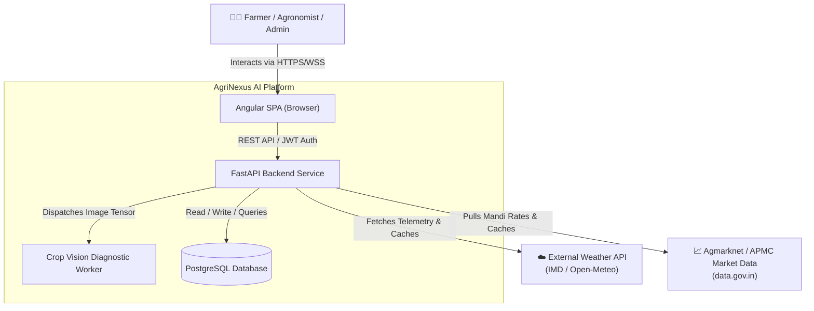
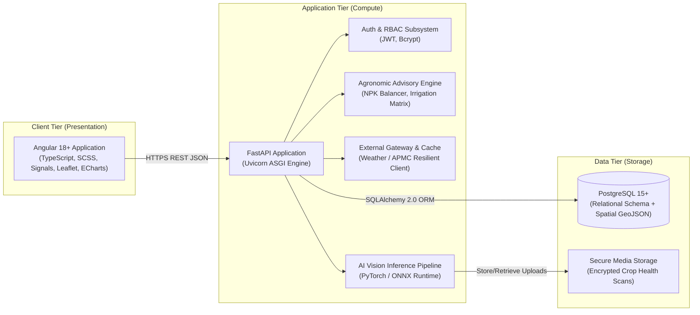

# AgriNexus AI — System Architecture Document
**Project:** AgriNexus AI – Intelligent Farm Operations & Decision Support Platform  
**Target Organization:** HCL Project Demonstration & Technical Evaluation  
**Project Group:** Group 9  
- Omsaish Kishor Dhokchaule  
- Sahil Keshav Jawale  
- Sarthak Balasaheb Harde  
- Abhijeet Pankaj Kanawade  
- Prathamesh Satish Shinde  

**Case Study Context:** 5-acre agricultural holding in Rahata, Ahilyanagar (Ahmednagar) District, Maharashtra, India.  
**Crops in Scope:** Onion (*Allium cepa*), Soybean (*Glycine max*), and Sugarcane (*Saccharum officinarum*).

---

## 1. Executive Summary & Architectural Vision

AgriNexus AI is an enterprise-grade Agricultural Technology (AgTech) Operations and Decision-Support Platform engineered for sustainable small-to-medium farm operations. It integrates geospatial field boundary mapping, soil chemistry analytics, localized agro-meteorological forecasting, APMC market commodity price tracking, and deep-learning leaf disease diagnostics into a cohesive, high-performance web platform.

The architectural philosophy emphasizes:
1. **Separation of Concerns:** Strict decoupling between presentation (Angular), core business orchestration (FastAPI), data persistence (PostgreSQL), and AI inference pipelines.
2. **Deterministic Security & Tenant Isolation:** Granular Role-Based Access Control (RBAC) ensuring farmers, extension agronomists, and administrators operate within strict perimeter boundaries.
3. **Resilience & Fault Tolerance:** Graceful degradation when third-party telemetry (weather, APMC prices) is unavailable through automated caching and fallback heuristics.
4. **Clean Code & Testability:** Every subsystem is independently testable, documented, and built to withstand technical audit and viva examination.

---

## 2. High-Level System Architecture (C4 Model)

### 2.1 C4 Context Diagram (System in Environment)



### 2.2 C4 Container Diagram (Component Interactions)



---

## 3. Subsystem Responsibilities

| Subsystem | Primary Responsibilities | Non-Functional Mandates |
| :--- | :--- | :--- |
| **Frontend (Angular)** | • User interface rendering with custom AgTech design system<br>• Parcel polygon drawing & coordinate editing via Leaflet<br>• ECharts telemetry visualizations (soil, weather, prices)<br>• Client-side token storage, HTTP interceptor injection<br>• Reactive state management via Angular Signals & RxJS | • Lighthouse Performance score ≥ 90<br>• Strict SCSS design tokens (No ad-hoc inline styles)<br>• Zero layout shift on dynamic data load |
| **Backend (FastAPI)** | • REST API route handling with Pydantic v2 validation<br>• JWT authentication, refresh lifecycle, and permission checks<br>• Business rules: fertilizer calculation, crop stage logic<br>• Asynchronous third-party API polling and fallback storage<br>• Database transactions, migrations, and audit logging | • Sub-100ms P95 latency for internal CRUD<br>• Clean Architecture (Repository/Service/Router layers)<br>• Comprehensive OpenAPI v3.1 documentation |
| **Database (PostgreSQL)** | • ACID relational storage for users, farms, parcels, tests, and logs<br>• Spatial/JSONB storage for farm boundary GeoJSON geometries<br>• B-Tree and GIN indexes for rapid querying by farm, date, and crop<br>• Strict foreign key integrity and audit timestamps | • Foreign keys enforced with cascading rules<br>• Normalized up to 3NF for transactional tables<br>• Automated database seeding for Rahata case study |
| **AI Inference Module** | • Image preprocessing (resizing to 224x224, normalization)<br>• Convolutional / Vision Transformer inference (Onion Purple Blotch, Soybean Rust, Sugarcane Red Rot)<br>• Confidence scoring, threshold gatekeeping (&lt;60% triggers uncertainty flag)<br>• Mapping predicted class to organic and chemical remediation protocols | • Inference time &lt; 500ms on CPU<br>• Clean separation from API controller for containerization<br>• Deterministic mock/stub mode for offline viva testing |

---

## 4. Complete Repository & Folder Structure

```text
AgriNexus-AI/
├── .gitignore
├── README.md
├── docs/
│   ├── PROJECT_ARCHITECTURE.md
│   ├── DATABASE_DESIGN.md
│   ├── API_DESIGN.md
│   ├── DEVELOPMENT_ROADMAP.md
│   ├── COMPONENT_HIERARCHY.md
│   └── SECURITY_PLAN.md
│
├── backend/
│   ├── app/
│   │   ├── __init__.py
│   │   ├── main.py                  # FastAPI application entrypoint & middleware
│   │   ├── core/                    # Core infrastructural configuration
│   │   │   ├── __init__.py
│   │   │   ├── config.py            # Pydantic BaseSettings (env vars)
│   │   │   ├── database.py          # SQLAlchemy engine, session maker, base class
│   │   │   ├── security.py          # Password hashing, JWT encode/decode
│   │   │   └── exceptions.py        # Global custom exception classes & handlers
│   │   ├── models/                  # SQLAlchemy ORM models
│   │   │   ├── __init__.py
│   │   │   ├── user.py
│   │   │   ├── farm.py
│   │   │   ├── parcel.py
│   │   │   ├── soil_test.py
│   │   │   ├── crop_scan.py
│   │   │   ├── market_price.py
│   │   │   ├── weather_cache.py
│   │   │   └── advisory.py
│   │   ├── schemas/                 # Pydantic validation schemas (DTOs)
│   │   │   ├── __init__.py
│   │   │   ├── auth.py
│   │   │   ├── user.py
│   │   │   ├── farm.py
│   │   │   ├── parcel.py
│   │   │   ├── soil.py
│   │   │   ├── ai_diagnostic.py
│   │   │   ├── weather.py
│   │   │   └── market.py
│   │   ├── api/                     # REST API routers (v1)
│   │   │   ├── __init__.py
│   │   │   ├── deps.py              # Dependency injection (DB session, current user)
│   │   │   └── v1/
│   │   │       ├── __init__.py
│   │   │       ├── router.py        # Consolidated API router aggregating endpoints
│   │   │       ├── auth.py          # Login, Register, Refresh, Me
│   │   │       ├── farms.py         # Farm CRUD & parcels management
│   │   │       ├── soil.py          # Soil chemistry analysis & recommendations
│   │   │       ├── ai.py            # Crop leaf disease classification
│   │   │       ├── weather.py       # Weather forecast & agro-advisory integration
│   │   │       ├── market.py        # APMC mandi rates for Maharashtra districts
│   │   │       └── analytics.py     # Aggregated telemetry for dashboard ECharts
│   │   ├── services/                # Business logic & external clients
│   │   │   ├── __init__.py
│   │   │   ├── agronomy_service.py  # NPK deficiency heuristics, irrigation calculators
│   │   │   ├── weather_service.py   # Open-Meteo / IMD HTTP client with DB fallback
│   │   │   ├── market_service.py    # Agmarknet scraper/API client with fallback
│   │   │   └── ai_vision_service.py # Image loader, inference handler, remedy mapper
│   │   └── ml_models/               # Model weights, class indices, and labels
│   │       ├── __init__.py
│   │       ├── labels.json          # Class labels (Onion, Soybean, Sugarcane diseases)
│   │       └── model_stub.py        # Deterministic PyTorch/TFLite/ONNX runner
│   ├── tests/
│   │   ├── __init__.py
│   │   ├── conftest.py              # Pytest fixtures, test database setup
│   │   ├── test_auth.py
│   │   ├── test_farms.py
│   │   ├── test_soil.py
│   │   └── test_ai_diagnostic.py
│   ├── alembic/                     # Database migrations
│   │   ├── env.py
│   │   └── versions/
│   ├── alembic.ini
│   ├── requirements.txt
│   └── run.py                       # Local ASGI development server launcher
│
├── frontend/
│   ├── angular.json
│   ├── package.json
│   ├── tsconfig.json
│   ├── tsconfig.app.json
│   ├── src/
│   │   ├── index.html
│   │   ├── main.ts
│   │   ├── styles.scss              # Global design system tokens & base typography
│   │   ├── assets/
│   │   │   ├── icons/
│   │   │   ├── images/
│   │   │   └── samples/             # Sample disease leaves for demonstration
│   │   ├── environments/
│   │   │   ├── environment.ts
│   │   │   └── environment.prod.ts
│   │   └── app/
│   │       ├── app.component.ts
│   │       ├── app.component.html
│   │       ├── app.routes.ts        # Modular routing definition
│   │       ├── core/                # Singletons (Services, Guards, Interceptors)
│   │       │   ├── guards/
│   │       │   │   ├── auth.guard.ts
│   │       │   │   └── role.guard.ts
│   │       │   ├── interceptors/
│   │       │   │   ├── auth.interceptor.ts
│   │       │   │   └── error.interceptor.ts
│   │       │   ├── services/
│   │       │   │   ├── api.service.ts
│   │       │   │   ├── auth.service.ts
│   │       │   │   ├── farm.service.ts
│   │       │   │   ├── weather.service.ts
│   │       │   │   ├── market.service.ts
│   │       │   │   └── ai-diagnostic.service.ts
│   │       │   └── models/          # TypeScript interfaces mirroring backend DTOs
│   │       │       ├── user.model.ts
│   │       │       ├── farm.model.ts
│   │       │       ├── weather.model.ts
│   │       │       ├── market.model.ts
│   │       │       └── ai-diagnostic.model.ts
│   │       ├── shared/              # Reusable UI presentation components
│   │       │   ├── components/
│   │       │   │   ├── navbar/
│   │       │   │   ├── sidebar/
│   │       │   │   ├── stat-card/
│   │       │   │   ├── echart-card/
│   │       │   │   ├── geo-map/
│   │       │   │   ├── alert-banner/
│   │       │   │   └── status-badge/
│   │       │   └── pipes/
│   │       └── features/            # Business feature domains (Lazy-loaded)
│   │           ├── auth/            # Login, Registration pages
│   │           ├── dashboard/       # Main Executive Overview
│   │           ├── parcels/         # Parcel boundary drawing & crop details
│   │           ├── soil-health/     # NPK balance, EC, pH analysis
│   │           ├── disease-detector/# Drag-and-drop leaf scanner & remedies
│   │           ├── weather/         # 7-day agro-meteorological forecasting
│   │           └── market-trends/   # APMC price graphs & harvest timing
│
└── scripts/
    ├── init_db.py                   # Automated PostgreSQL database initializer & seeder
    └── test_connectivity.py         # Automated Phase 1 verification script
```

---

## 5. Architectural Decisions & Trade-Off Matrix

| Category | Decision | Alternative Evaluated | Justification for AgriNexus AI |
| :--- | :--- | :--- | :--- |
| **Frontend Framework** | **Angular 18+ (Standalone)** | React / Vue | Native enterprise tooling, TypeScript-first consistency, dependency injection, and strict HCL enterprise requirements. |
| **Backend Framework** | **FastAPI (Python 3.11+)** | Django REST / Flask / Node.js | Native Python compatibility with PyTorch/TensorFlow AI vision workloads, asynchronous high-throughput I/O, automatic OpenAPI schema generation, and strict Pydantic v2 validation. |
| **Persistence Store** | **PostgreSQL** | MongoDB / MySQL | ACID compliance for financial/market and soil test audits, relational foreign-key integrity between farms/parcels/tests, native JSONB for flexible GeoJSON polygon coordinates, and future PostGIS support. |
| **Charting Engine** | **Apache ECharts** | Chart.js / D3.js | Superior rendering performance with canvas/SVG for complex temporal agro-meteorological series, interactive tooltips, zoom sliders, and professional visual styling suitable for enterprise SaaS. |
| **Geospatial Mapping** | **Leaflet** | Google Maps API | Open-source, zero API-key billing dependencies for project evaluation, high modularity for custom GeoJSON polygon layers, and offline map tile capability. |
| **Communication Protocol** | **RESTful JSON** | GraphQL / gRPC | Simplicity of debugging in browser dev tools, strict HTTP status codes, standard OpenAPI specification generation, and clear caching semantics for APMC mandi rates. |

---

## 6. Technical Dependencies and Integration Risks

### 6.1 Identified Risks & Engineering Mitigations

1. **Risk: Fluctuating or Unreachable External Weather / Mandi APIs**
   - *Impact:* Dashboard failures, missing market trends during project viva or evaluation.
   - *Mitigation:* Implement a **Cache-Aside Pattern** in the FastAPI backend. All successful requests to Open-Meteo or Agmarknet are stored in PostgreSQL with a `valid_until` TTL timestamp. If the external network request times out (&gt;3 seconds), the backend automatically serves the latest cached snapshot with an `is_cached: true` flag.

2. **Risk: Resource-Heavy AI Inference on CPU-only Environments**
   - *Impact:* High latency or out-of-memory errors when processing high-resolution leaf camera images.
   - *Mitigation:* The AI service automatically downsamples incoming images to $224 \times 224$ pixels, applies bilinear interpolation, and uses an optimized lightweight MobileNetV3 / ResNet-18 architecture with an optional deterministic fallback inference engine for demonstration stability.

3. **Risk: Complex Angular-Leaflet Lifecycle Bugs**
   - *Impact:* Map container not resizing correctly when switching between dashboard tabs.
   - *Mitigation:* Encapsulate Leaflet in a dedicated Angular component with explicit `ngAfterViewInit` lifecycle hooks and automatic `map.invalidateSize()` calls triggered on window resize or tab transitions.

4. **Risk: CORS and Local Development Port Conflicts**
   - *Impact:* Frontend unable to communicate with backend during evaluation.
   - *Mitigation:* Explicit CORS middleware in FastAPI allowing `http://localhost:4200` with strict credential headers, combined with automated health-check verification endpoints (`/api/v1/health`).
