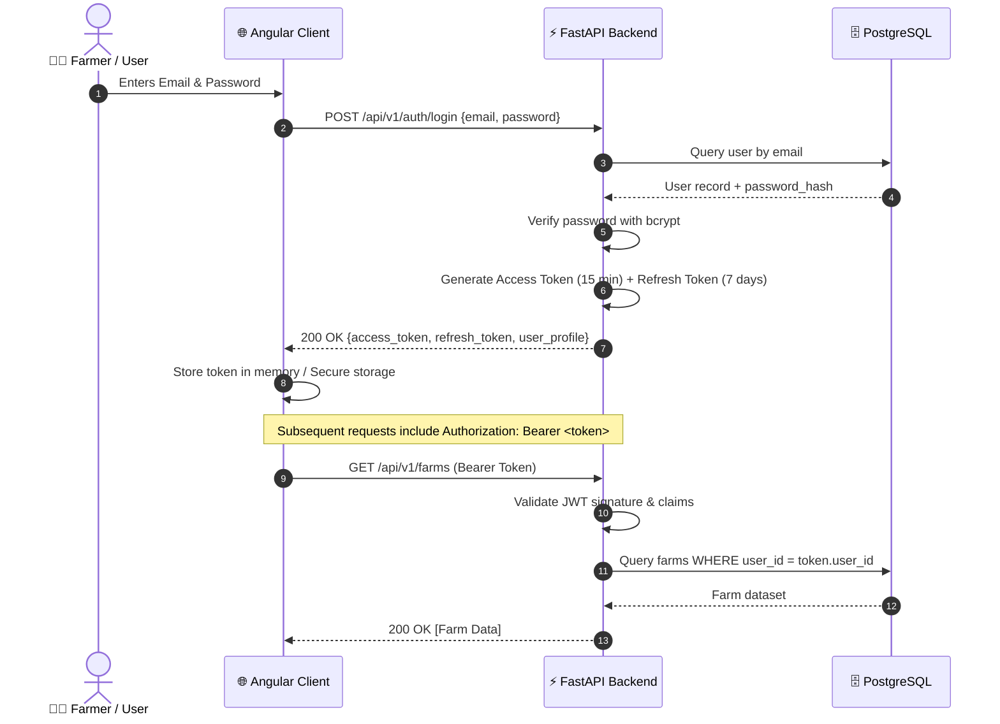

# AgriNexus AI — Security, Authorization & Governance Plan
**Compliance Standard:** OWASP Top 10 Application Security  
**Evaluation Target:** Enterprise HCL Review & Technical Viva  
**Project Group:** Group 9  

---

## 1. Threat Modeling (STRIDE Analysis)

| Threat Category | Potential Attack Vector in AgriNexus AI | Implemented Countermeasure |
| :--- | :--- | :--- |
| **Spoofing** | Attacker attempts to impersonate a farmer or agronomist via forged tokens. | Cryptographically signed RS256 / HS256 JWT tokens with 15-minute expiration; secure refresh token rotation. |
| **Tampering** | Malicious alteration of soil test results or parcel boundaries in transit. | HTTPS / TLS 1.3 encryption in transit; cryptographic password hashing with bcrypt (cost factor 12); Pydantic payload validation. |
| **Repudiation** | User denies performing an action (e.g., deleting a farm parcel or altering diagnostic scans). | Dedicated `audit_logs` table tracking user ID, IP address, timestamp, action, and target entity for all mutating operations. |
| **Information Disclosure** | Unauthorized user accessing another farmer's proprietary yield or location data. | Strict tenant isolation via Row-Level Security and FastAPI dependency injection (`get_current_active_user`) verifying farm ownership before query execution. |
| **Denial of Service** | Flooding the AI vision model endpoint with huge file uploads to exhaust CPU/memory. | Rate limiting via `SlowAPI` (e.g., 10 scans/minute per IP); strict multipart file size capping (max 10MB); MIME-type verification. |
| **Elevation of Privilege** | Standard farmer account attempting to access agronomist or administrative review endpoints. | Role-Based Access Control (`RBAC`) enforced at the FastAPI route decorator level (`require_role(["ADMIN", "AGRONOMIST"])`). |

---

## 2. Authentication Architecture

### 2.1 Password Hashing Specification
- **Algorithm:** `bcrypt`
- **Rounds (Work Factor):** `12`
- **Salt:** Generated uniquely per user via `bcrypt.gensalt(12)`
- **Policy Enforcement:** Minimum 8 characters, at least 1 uppercase letter, 1 number, and 1 special symbol.

### 2.2 Token Management
- **Access Token:** Short-lived (15 minutes), containing subject (`sub`: user UUID), role (`role`), and expiration timestamp (`exp`).
- **Refresh Token:** Long-lived (7 days), stored securely and revocable upon user logout.

---

## 3. Role-Based Access Control (RBAC) Matrix

| Resource / Endpoint | Farmer | Agronomist | Administrator |
| :--- | :---: | :---: | :---: |
| View Own Farm & Parcels | ✅ Read/Write | ✅ Read-Only (Assigned) | ✅ Full Access |
| Create / Edit Parcels | ✅ Own Parcels | ❌ Forbidden | ✅ Full Access |
| View Soil Tests | ✅ Own Tests | ✅ Read / Add Analysis | ✅ Full Access |
| Submit AI Leaf Disease Scan | ✅ Own Crops | ✅ Any Crop | ✅ Full Access |
| View APMC Market & Weather | ✅ Public Read | ✅ Public Read | ✅ Public Read |
| Modify Master Disease Taxonomy | ❌ Forbidden | ❌ Forbidden | ✅ Full Access |
| Access System Audit Logs | ❌ Forbidden | ❌ Forbidden | ✅ Full Access |

---

## 4. Input Validation & Injection Prevention

1. **SQL Injection Prevention:**
   - 100% of database interactions occur via SQLAlchemy 2.0 ORM using parameterized queries. Raw SQL string concatenation is strictly prohibited across the codebase.
2. **Cross-Site Scripting (XSS) Prevention:**
   - Angular automatically treats all values as untrusted by default. Context-aware DOM sanitization escapes HTML, styles, and script attributes prior to rendering.
3. **Cross-Site Request Forgery (CSRF):**
   - Since authentication utilizes stateless `Authorization: Bearer <token>` headers instead of ambient browser cookies, classical CSRF attacks are fundamentally mitigated.
4. **Secure File Upload Pipeline for Leaf Scans:**
   - Images uploaded to `/api/v1/crops/diagnose` are inspected for true magic bytes (`python-magic` / Pillow verification) rather than relying on the client-provided file extension.
   - Files are strictly capped at $10\text{ MB}$.
   - Uploaded files are stored with random UUID filenames outside the web server root to prevent arbitrary script execution.

---

## 5. Environment Secrets & Configuration Hygiene

- All sensitive keys (`DATABASE_URL`, `JWT_SECRET_KEY`, `ALGORITHM`, `WEATHER_API_KEY`) are loaded via Pydantic `BaseSettings` reading from `.env`.
- `.env` is permanently registered in `.gitignore` and never committed to version control.
- An annotated `.env.example` file is provided documenting all required environment variables with non-secret local defaults.

---

## 6. Audit Logging & Observability

- Every modifying transaction (create, update, delete) records a structured entry in `audit_logs`:
  - `user_id`: Operator UUID
  - `action`: e.g., `PARCEL_CREATED`, `SOIL_TEST_LOGGED`, `DIAGNOSTIC_SCAN_EXECUTED`
  - `resource_type`: e.g., `parcel`, `soil_test`
  - `resource_id`: UUID of impacted entity
  - `ip_address`: Client remote IP
  - `timestamp`: UTC microsecond timestamp
